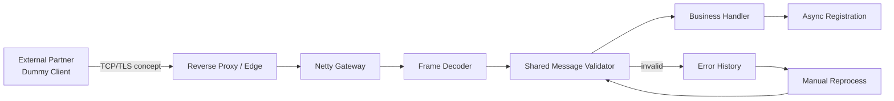

# Financial E-Document Gateway Portfolio

A **clean-room portfolio reconstruction** of a financial electronic-document message gateway using Java and Netty.

> This repository does **not** contain employer/client source code, real message specifications, database schemas, hostnames, IPs, ports, certificates, keys, tokens, logs, screenshots, or internal documents. The protocol and data model in this repository are intentionally fictional.

## What this demonstrates

- Netty-based TCP message receiving pipeline
- Length-prefixed frame decoding and protocol parsing
- Shared validation used by both initial receipt and manual reprocessing
- Partner-specific configuration separation
- Error-history capture and controlled reprocessing
- Asynchronous downstream registration
- Testable boundaries between transport, validation, parsing, and business handling
- Architecture Decision Records for technical interviews

## Portfolio context

The production-inspired work modernized a legacy external-message receiving service into a Java/Netty-based structure. For confidentiality, this repository recreates only **generic engineering concepts** with a dummy protocol and synthetic data.

Read the sanitized [project story](docs/project-story.md) for the problem, decisions, reconstructed solution, and confidentiality boundary.

## Architecture



## Dummy protocol

The sample protocol is deliberately unrelated to any production specification.

Each frame is:

```text
[4-byte big-endian payload length][UTF-8 JSON payload]
```

Example JSON:

```json
{
  "requestId": "DEMO-20261030-0001",
  "messageType": "DOCUMENT_REGISTER",
  "timestamp": "2026-10-30T10:00:00Z",
  "payload": "synthetic-demo-data",
  "checksum": "sha256-hex"
}
```

## Processing flow

1. Decode one length-prefixed frame.
2. Parse dummy JSON into `DummyMessage`.
3. Validate required fields, type, payload size, and checksum.
4. On validation failure, persist a synthetic `ErrorRecord` in an in-memory repository.
5. On success, hand off to an asynchronous downstream-registration service.
6. Failed records can be manually reprocessed through `ReprocessService`.
7. Reprocessing uses the same `MessageValidator` used during initial receipt.

See [`docs/processing-flow.md`](docs/processing-flow.md) and [`docs/adr`](docs/adr).

## Build

Requirements:

- JDK 8+
- Maven 3.8+

```bash
mvn test
mvn package
```

## Run

```bash
java -jar target/financial-edoc-gateway-portfolio-1.0.0-SNAPSHOT-jar-with-dependencies.jar
```

Default demo bind address is loopback only (`127.0.0.1`) and port `19090`. These are **portfolio-only values**.

## Repository structure

```text
src/main/java/.../protocol     dummy protocol model/parser
src/main/java/.../pipeline     Netty frame + validation handlers
src/main/java/.../service      validation / async registration / reprocessing
src/main/java/.../repository   in-memory error history
src/main/java/.../config       partner-specific demo settings
docs/adr                       architecture decision records
docs/project-story.md          sanitized project narrative
```

## Interview talking points

- Why replace a hard-to-maintain native socket service with Java/Netty?
- How should transport framing be separated from business validation?
- Why externalize partner-specific differences instead of branching business code?
- How should invalid messages be recorded for diagnosis and controlled reprocessing?
- Why should reprocessing reuse the same validation rules as initial receipt?
- Where should synchronous acknowledgement end and asynchronous internal work begin?
- What should be logged without exposing sensitive financial data?

## Confidentiality boundary

See [`SECURITY.md`](SECURITY.md). The rule for this repository is simple: **reproduce concepts, never reproduce proprietary artifacts**.
