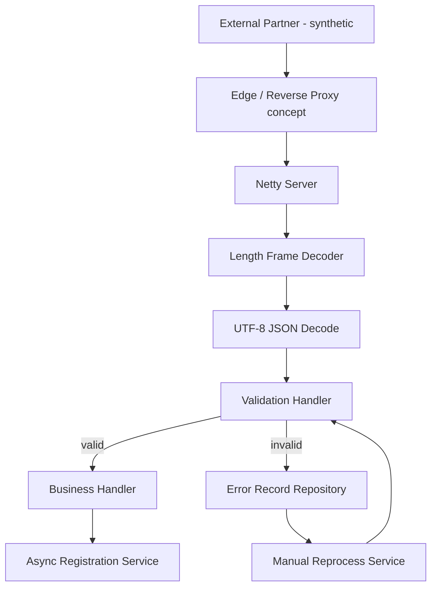

# Architecture

## Goal

Separate transport, framing, validation, business handling, error history, and downstream registration so each concern can be tested and changed independently.

## Boundaries

- **Transport**: TCP connection and frame boundaries only.
- **Protocol**: parse fictional JSON payload.
- **Validation**: required-field, type, size, checksum checks.
- **Business**: accept valid document-registration request.
- **Async registration**: simulate internal downstream processing.
- **Error history**: retain synthetic raw payload and reason for diagnosis/reprocessing.

No production network topology or internal naming is reproduced.
