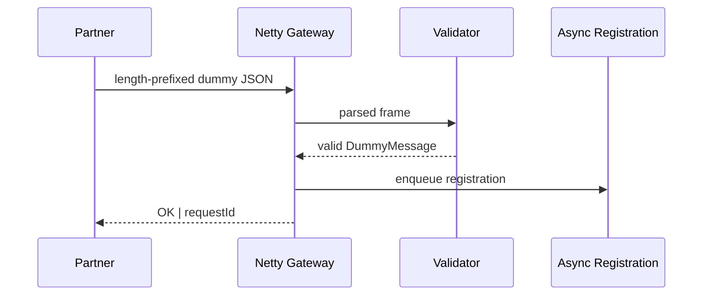
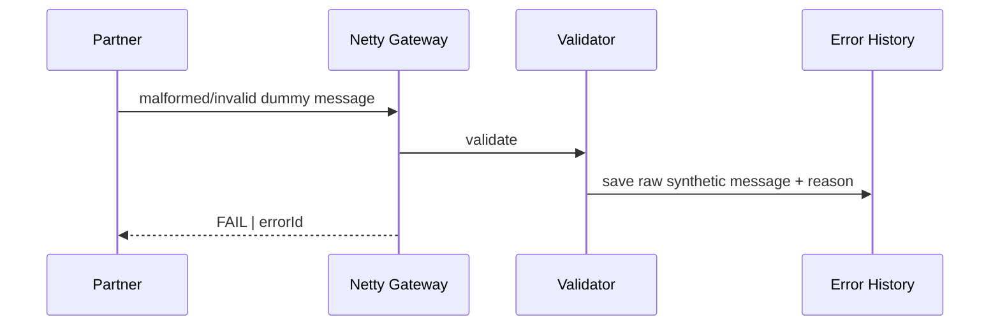

# Processing Flow

## Success

## Validation failure

## Reprocessing

The sample keeps the original synthetic payload for diagnosis. An operator can later select one error record and retry it through `ReprocessService`. The same `MessageValidator` used during initial receipt is reused before downstream registration.

The production implementation that inspired this portfolio used a richer operational flow, but none of its real schemas, fields, or message layouts are reproduced here.
